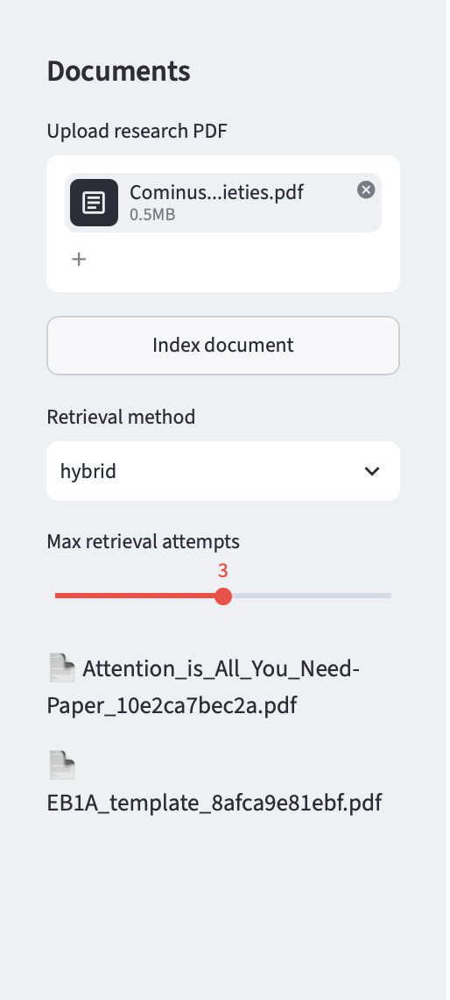
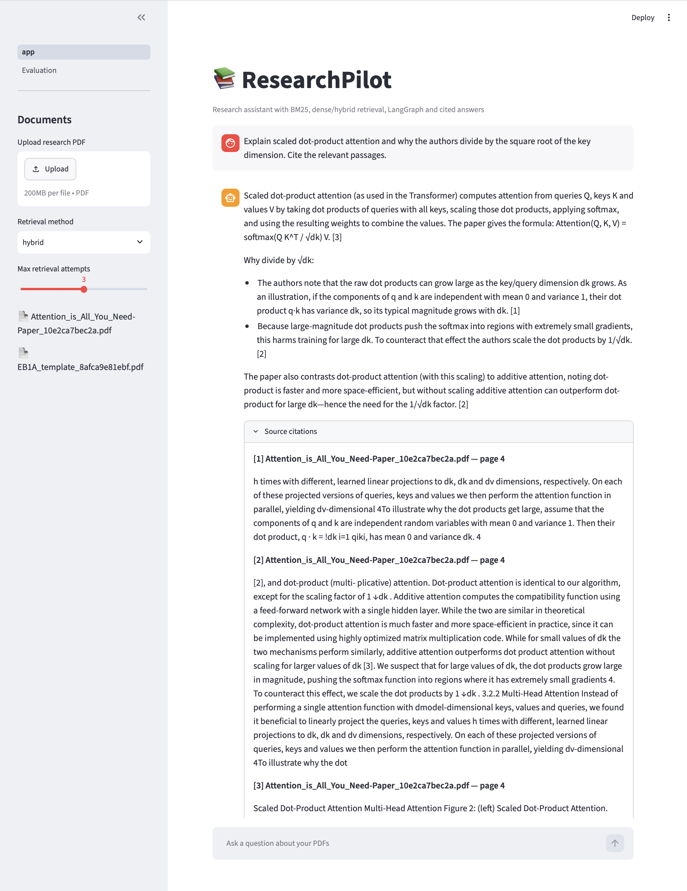
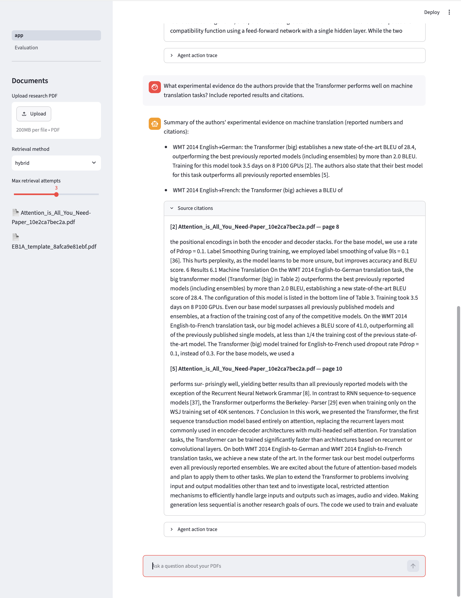
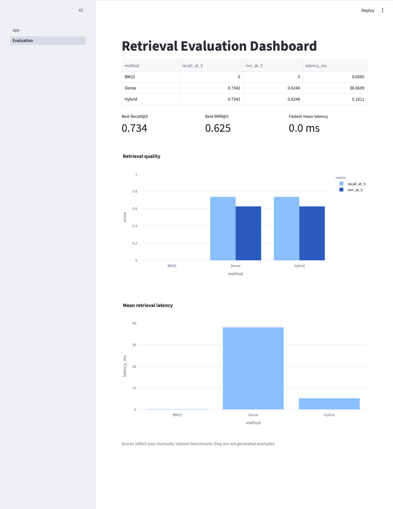
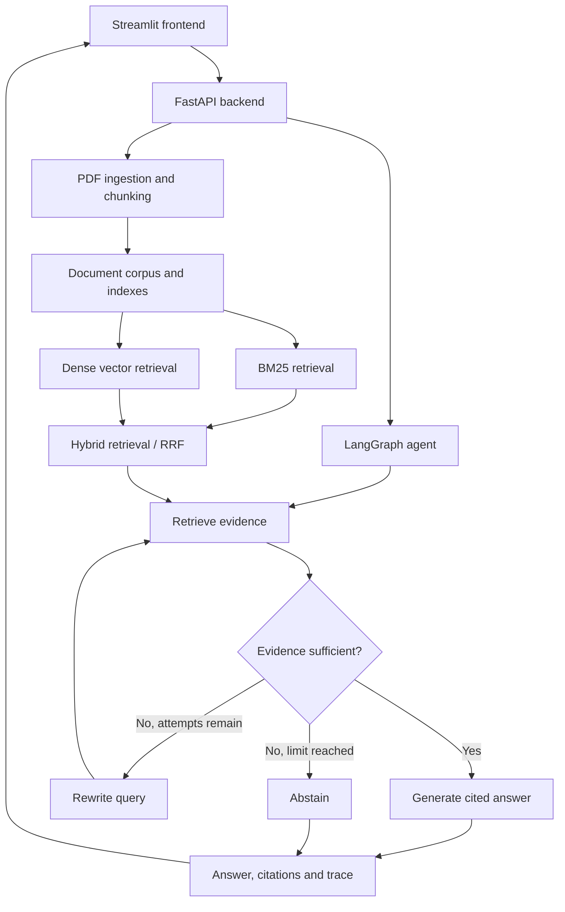

# 📚 ResearchPilot

**An agentic research assistant for academic PDFs — combining hybrid information retrieval, evidence-aware generation, and retrieval evaluation.**

ResearchPilot lets users upload research papers, ask technical questions in natural language, and inspect answers alongside their supporting passages. Rather than treating retrieved text as automatically reliable, its LangGraph workflow evaluates whether the available evidence is sufficient, can reformulate a query and retrieve again, and abstains when the documents do not support an answer.

Built as a software engineering and applied AI portfolio project, ResearchPilot brings together document processing, information retrieval, LLM orchestration, API development, and quantitative evaluation.

## Demo

### 1. Upload and index research papers



Upload a PDF through the Streamlit interface and index its text for retrieval. Users can select **BM25**, **Dense**, or **Hybrid** retrieval and configure the maximum number of agent retrieval attempts.

### 2. Ask technical questions with source-grounded answers



**Example question:**

> Explain scaled dot-product attention and why the authors divide by the square root of the key dimension. Cite the relevant passages.

The assistant answers using passages from *Attention Is All You Need*, including the attention equation and the motivation for scaling by `1/√dₖ`. The interface displays numbered citations, source document names, page numbers, and supporting excerpts so readers can check the evidence.

**Additional examples**

| Question | Capability illustrated | Screenshot |
| --- | --- | --- |
| What experimental evidence shows that the Transformer performs well on machine translation? | Retrieving reported BLEU scores and experimental findings | [Translation results](docs/screenshots/02-grounded-answer-2.png) |
| Explain scaled dot-product attention and the scaling factor. | Technical explanation grounded in paper excerpts | [Attention explanation](docs/screenshots/02-grounded-answer-3.png) |
| Compare Transformers with recurrent and convolutional sequence-to-sequence models. | Synthesizing architectural and computational tradeoffs | [Model comparison](docs/screenshots/02-grounded-answer-4.png) |

### 3. Inspect the agent's evidence-driven workflow



**Example question:**

> What experimental evidence do the authors provide that the Transformer performs well on machine translation tasks? Include reported results and citations.

The agent uses a conditional workflow:

1. **Retrieve:** Find candidate passages from indexed PDFs.
2. **Grade evidence:** Determine whether the passages adequately support the question.
3. **Rewrite and retry (if needed):** Reformulate the query and retrieve again, up to the configured attempt limit.
4. **Generate or abstain:** Produce a cited answer when evidence is sufficient, or state that the documents do not provide enough support.

The Streamlit interface includes an **Agent action trace** expander for inspecting the steps taken for a particular answer. A rewrite is conditional; it does not occur on every request.

### 4. Evaluate retrieval methods



The evaluation dashboard reports **Recall@5**, **MRR@5** (Mean Reciprocal Rank), and mean retrieval latency for BM25, dense, and hybrid search.

**Results shown in the captured dashboard**

| Retrieval method | Recall@5 | MRR@5 | Mean latency (ms) |
| --- | ---: | ---: | ---: |
| BM25 | 0.0000 | 0.0000 | 0.0095 |
| Dense | 0.7342 | 0.6248 | 38.0609 |
| Hybrid | 0.7342 | 0.6248 | 5.1611 |

These are the values visible in the captured evaluation run, **not general performance guarantees**. In this run, hybrid matched dense retrieval quality while showing lower measured latency. The zero BM25 score warrants further investigation of indexing, tokenization, corpus/ground-truth alignment, and benchmark setup before drawing conclusions about lexical retrieval quality. Latency results also depend on caching, hardware, corpus size, and measurement methodology.

## Features

- **Academic PDF ingestion:** Extract and chunk document text for retrieval.
- **Three retrieval strategies:** BM25 keyword matching, dense semantic retrieval, and hybrid fusion using Reciprocal Rank Fusion (RRF).
- **Agentic RAG:** LangGraph workflow with evidence grading, conditional query rewriting, bounded retries, and abstention.
- **Verifiable answers:** Numbered citations linked to document excerpts and page references.
- **REST API:** FastAPI endpoints for document upload, chat, document listing, and evaluation results.
- **Interactive frontend:** Streamlit chat interface, document controls, source citations, and agent traces.
- **Evaluation:** Recall@K, MRR, and retrieval latency for comparing retrieval strategies.

## Architecture



The retriever selected by the user supplies the agent's retrieval step. Hybrid retrieval combines lexical and semantic rankings through RRF; the agent then decides whether the retrieved context is sufficient for a grounded response.

## Tech stack

| Layer | Technologies |
| --- | --- |
| Language | Python |
| Frontend | Streamlit |
| API | FastAPI, Pydantic |
| Agent orchestration | LangGraph |
| LLM | OpenAI API |
| Embeddings | Sentence Transformers (`all-MiniLM-L6-v2`) |
| Vector database | ChromaDB |
| Keyword retrieval | BM25 |
| Hybrid fusion | Reciprocal Rank Fusion (RRF) |
| PDF processing | PyMuPDF |
| Evaluation | Recall@K, MRR, latency |

## Getting started

### Prerequisites

- Python 3.11 or newer (tested locally with Python 3.12)
- An OpenAI API key with available API credits

### Installation

```bash
git clone <YOUR_REPOSITORY_URL>
cd researchpilot-complete
python3 -m venv .venv
source .venv/bin/activate
pip install -r requirements.txt
cp .env.example .env
```

Add your API key to `.env`:

```dotenv
OPENAI_API_KEY=your_api_key_here
```

Keep `.env` private; never commit API keys or credentials to GitHub. If the project uses an `OPENAI_MODEL` variable, configure it in `.env` as appropriate for your account.

### Run the application

In **Terminal 1**, start the API:

```bash
source .venv/bin/activate
uvicorn researchpilot.api.main:app --reload
```

In **Terminal 2**, start the frontend:

```bash
source .venv/bin/activate
streamlit run frontend/app.py
```

Open **http://localhost:8501** in your browser. The API runs at **http://127.0.0.1:8000**, with interactive API documentation at **http://127.0.0.1:8000/docs**.

### Try the demo

1. Upload *Attention Is All You Need* or another research PDF and index it.
2. Select **Hybrid** retrieval and set the maximum retrieval attempts.
3. Ask: *“Explain scaled dot-product attention and why the authors divide by the square root of the key dimension. Cite the relevant passages.”*
4. Inspect the numbered source citations and the **Agent action trace**.
5. Open **Evaluation** to inspect available retrieval benchmark results.

## Engineering considerations

**Grounding and abstention.** A fluent answer is not necessarily a supported answer. ResearchPilot separates evidence assessment from answer generation and can abstain when the indexed documents do not justify a response.

**Retrieval tradeoffs.** Lexical and embedding-based retrieval capture different kinds of relevance. ResearchPilot implements both and uses RRF to combine rankings in hybrid mode, while exposing evaluation metrics instead of assuming one method always wins.

**Inspectability.** The UI exposes source excerpts, page references, and an agent trace to make individual answers easier to review and debug.

**Limitations and next steps.** PDF extraction may struggle with complex layouts, tables, or equations; chunk boundaries can separate related evidence; citation quality still requires verification; and the captured benchmark is not sufficient to establish broad retrieval performance. Planned improvements include more diverse labeled queries, investigation of the BM25 baseline, repeated latency measurements, and stronger automated regression tests for evidence grading and abstention.

## Project structure

```text
researchpilot-complete/
├── researchpilot/
│   ├── agent/             # LangGraph state, nodes, and workflow
│   ├── api/               # FastAPI endpoints and services
│   ├── retrieval/         # BM25, hybrid retrieval, corpus helpers
│   ├── evaluation/        # Retrieval metrics and benchmarks
│   ├── pdf_loader.py      # PDF text extraction
│   ├── chunker.py         # Text chunking
│   ├── vector_store.py    # Dense indexing and search
│   └── generator.py       # Grounded answer generation
├── frontend/
│   ├── app.py             # Streamlit chat UI
│   └── pages/             # Evaluation dashboard
├── docs/
│   └── screenshots/       # README demo images
├── requirements.txt
├── .env.example
└── README.md
```

## Motivation

ResearchPilot explores a central challenge in practical AI systems: **how to retrieve relevant information, decide whether the evidence is sufficient, and present answers that a user can verify**. The project combines algorithms, backend engineering, applied NLP, and evaluation in an end-to-end research workflow.

---

*Demo paper: Vaswani et al., [“Attention Is All You Need”](https://arxiv.org/abs/1706.03762) (2017).*
