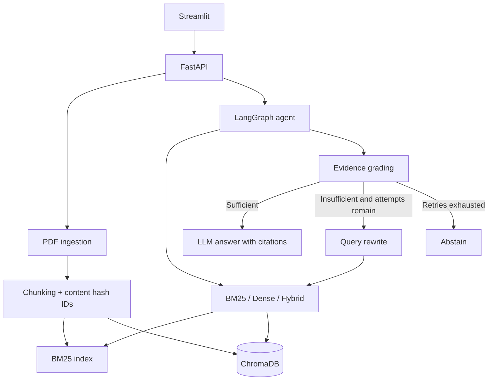

# ResearchPilot Architecture

The service is a single-process prototype. Index rebuilds use an in-process lock, not a distributed transaction. It must not be deployed as an unauthenticated multi-user service. The evidence grader is probabilistic; valid citation IDs do not prove citation faithfulness.
